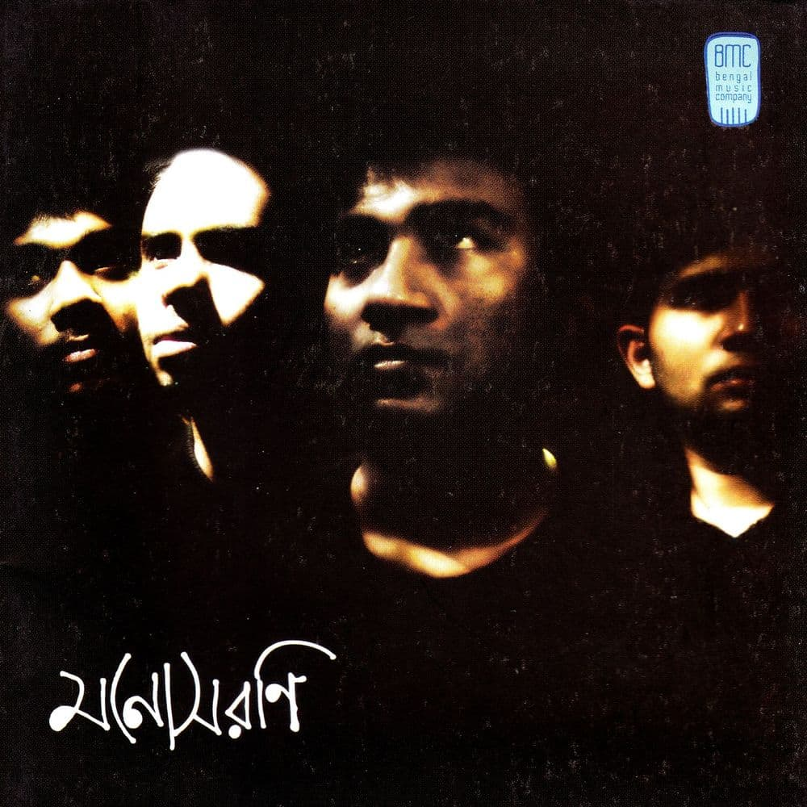

# 🎸 Monosoroni (মনসরণি)

[](https://github.com/BD-Band-Archive/BD-Band-Music) [](#) [](#) [](#)

<p align="center">
  
</p>

## 🌟 About the Band

> **Monosoroni** is an acclaimed Bangladeshi folk-rock, acoustic rock, and philosophical pop outfit. Known for their organic acoustic arrangements, deeply introspective and social lyricism, and poignant vocal textures, their self-titled album *Monosoroni* remains a cherished masterpiece in modern Bangladeshi acoustic rock.

🎵 **Stream Lossless Audio Online:** [BD Band Music Player](https://bd-band-music.pages.dev/) &bull; [Mirror](https://bd-band-music.netlify.app/)

---

## 📑 Discography Index

1. [Monosoroni (মনসরণি) (2013)](#1-monosoroni-2013)

---

<a id="1-monosoroni-2013"></a>
## 1. Monosoroni (মনসরণি) (2013)

- **Artist:** Monosoroni
- **Release Year:** 2013
- **Audio Quality:** Lossless FLAC (16-bit / 44.1 kHz)

<p align="center">
  
</p>

### 📖 About the Album
Released in 2013, *Monosoroni* is the celebrated eponymous debut studio album by Monosoroni. Packed with twelve deeply reflective, acoustic-driven tracks, the record explores humanity, nostalgia, existential questions, and love through gems like *"Nirjon Ovoyaronno"*, *"Tomake Chara"*, *"Manush Na Kritodash"*, and *"Ma-Ke Lekha Chithi"*.

### 🎵 Tracklist (One-Tap Download)

- [**01. Nirjon Ovoyaronno**](https://media.githubusercontent.com/media/BD-Band-Archive/Monosoroni/master/Monosoroni%20%282013%29/01%20-%20Nirjon%20Ovoyaronno.flac?download=true) &nbsp; [](https://media.githubusercontent.com/media/BD-Band-Archive/Monosoroni/master/Monosoroni%20%282013%29/01%20-%20Nirjon%20Ovoyaronno.flac?download=true)
- [**02. Tomake Chara**](https://media.githubusercontent.com/media/BD-Band-Archive/Monosoroni/master/Monosoroni%20%282013%29/02%20-%20Tomake%20Chara.flac?download=true) &nbsp; [](https://media.githubusercontent.com/media/BD-Band-Archive/Monosoroni/master/Monosoroni%20%282013%29/02%20-%20Tomake%20Chara.flac?download=true)
- [**03. Manush Na Kritodash**](https://media.githubusercontent.com/media/BD-Band-Archive/Monosoroni/master/Monosoroni%20%282013%29/03%20-%20Manush%20Na%20Kritodash.flac?download=true) &nbsp; [](https://media.githubusercontent.com/media/BD-Band-Archive/Monosoroni/master/Monosoroni%20%282013%29/03%20-%20Manush%20Na%20Kritodash.flac?download=true)
- [**04. Rampam**](https://media.githubusercontent.com/media/BD-Band-Archive/Monosoroni/master/Monosoroni%20%282013%29/04%20-%20Rampam.flac?download=true) &nbsp; [](https://media.githubusercontent.com/media/BD-Band-Archive/Monosoroni/master/Monosoroni%20%282013%29/04%20-%20Rampam.flac?download=true)
- [**05. Jibon Maney Gormil**](https://media.githubusercontent.com/media/BD-Band-Archive/Monosoroni/master/Monosoroni%20%282013%29/05%20-%20Jibon%20Maney%20Gormil.flac?download=true) &nbsp; [](https://media.githubusercontent.com/media/BD-Band-Archive/Monosoroni/master/Monosoroni%20%282013%29/05%20-%20Jibon%20Maney%20Gormil.flac?download=true)
- [**06. Ma-Ke Lekha Chithi**](https://media.githubusercontent.com/media/BD-Band-Archive/Monosoroni/master/Monosoroni%20%282013%29/06%20-%20Ma-Ke%20Lekha%20Chithi.flac?download=true) &nbsp; [](https://media.githubusercontent.com/media/BD-Band-Archive/Monosoroni/master/Monosoroni%20%282013%29/06%20-%20Ma-Ke%20Lekha%20Chithi.flac?download=true)
- [**07. Mowno Mondir**](https://media.githubusercontent.com/media/BD-Band-Archive/Monosoroni/master/Monosoroni%20%282013%29/07%20-%20Mowno%20Mondir.flac?download=true) &nbsp; [](https://media.githubusercontent.com/media/BD-Band-Archive/Monosoroni/master/Monosoroni%20%282013%29/07%20-%20Mowno%20Mondir.flac?download=true)
- [**08. Homesick**](https://media.githubusercontent.com/media/BD-Band-Archive/Monosoroni/master/Monosoroni%20%282013%29/08%20-%20Homesick.flac?download=true) &nbsp; [](https://media.githubusercontent.com/media/BD-Band-Archive/Monosoroni/master/Monosoroni%20%282013%29/08%20-%20Homesick.flac?download=true)
- [**09. Attmwajiboni**](https://media.githubusercontent.com/media/BD-Band-Archive/Monosoroni/master/Monosoroni%20%282013%29/09%20-%20Attmwajiboni.flac?download=true) &nbsp; [](https://media.githubusercontent.com/media/BD-Band-Archive/Monosoroni/master/Monosoroni%20%282013%29/09%20-%20Attmwajiboni.flac?download=true)
- [**10. Jonmandher Kaanamachi Khela**](https://media.githubusercontent.com/media/BD-Band-Archive/Monosoroni/master/Monosoroni%20%282013%29/10%20-%20Jonmandher%20Kaanamachi%20Khela.flac?download=true) &nbsp; [](https://media.githubusercontent.com/media/BD-Band-Archive/Monosoroni/master/Monosoroni%20%282013%29/10%20-%20Jonmandher%20Kaanamachi%20Khela.flac?download=true)
- [**11. Tomake Khujechi**](https://media.githubusercontent.com/media/BD-Band-Archive/Monosoroni/master/Monosoroni%20%282013%29/11%20-%20Tomake%20Khujechi.flac?download=true) &nbsp; [](https://media.githubusercontent.com/media/BD-Band-Archive/Monosoroni/master/Monosoroni%20%282013%29/11%20-%20Tomake%20Khujechi.flac?download=true)
- [**12. Sudorshon Robot**](https://media.githubusercontent.com/media/BD-Band-Archive/Monosoroni/master/Monosoroni%20%282013%29/12%20-%20Sudorshon%20Robot.flac?download=true) &nbsp; [](https://media.githubusercontent.com/media/BD-Band-Archive/Monosoroni/master/Monosoroni%20%282013%29/12%20-%20Sudorshon%20Robot.flac?download=true)

### 🖼️ Album Artwork

| | |
| :---: | :---: |
| <br><sub><b>1. Front Cover</b></sub> |  |

---

### 💾 Git LFS & Downloading Audio
All audio tracks in this repository are managed via **Git LFS** (Large File Storage).
- **One-Tap Direct Download:** Click either the track title or the green download button next to any song to instantly save the file to your device.
- **To clone locally with all audio files:**
  ```bash
  git lfs install
  git clone https://github.com/BD-Band-Archive/Monosoroni.git
  ```

---

### 🤝 Contribution & DMCA Notice
All songs and archival materials in this repository were collected and curated from various internet sources, physical CD rips, and public community archives for cultural preservation and historical documentation.

- **Contributions:** If you have physical CD or cassette rips in lossless FLAC format, missing booklet/inlay scans, or tracklist metadata corrections, contributions and pull requests are warmly welcome!
- **DMCA / Copyright Notice:** If this repository contains your copyrighted or DMCA-protected files and you wish to have them removed, please contact:
  - **Email:** [maniruzzamanmridul@gmail.com](mailto:maniruzzamanmridul@gmail.com)
  
  Please provide the specific track, album, or file details, and the requested material will be reviewed and removed as soon as possible.
